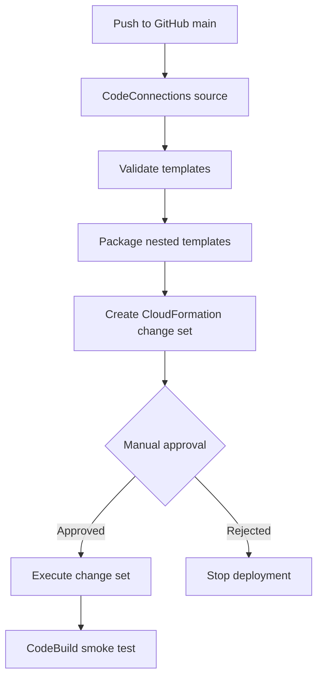

# AWS CloudFormation CI/CD Platform

A project demonstrating reusable CloudFormation templates, private application networking, and GitHub-triggered AWS CodePipeline delivery with CodeBuild validation, CloudFormation change sets, manual approval, deployment, and smoke testing.

## Architecture

- A root CloudFormation stack orchestrates network and application nested stacks.
- A VPC spans two Availability Zones, with public subnets for the internet-facing Application Load Balancer (ALB) and private subnets for application instances.
- An EC2 Auto Scaling group runs Amazon Linux 2023 instances without public IP addresses.
- Application ingress is permitted only from the ALB security group. SSH ingress is not defined.
- EC2 uses an instance profile for Systems Manager, requires IMDSv2, and uses encrypted gp3 EBS root volumes.
- The ALB target group has health checks, and CloudWatch monitors unhealthy targets.
- CodePipeline V2 uses queued execution mode and a manual approval gate before change-set execution.


### CI/CD workflow



## Repository layout

```text
templates/
  root.yaml             # Root stack and nested stack orchestration
  network.yaml          # VPC, subnets, routes and optional NAT Gateway
  application.yaml      # ALB, Auto Scaling, instance role, logs and alarm
  pipeline-stack.yaml   # CodePipeline, CodeBuild, S3 buckets and IAM roles
buildspec/
  validate.yml          # Lint, CloudFormation and JSON validation
  package.yml           # Package and validate nested templates
  smoke-test.yml        # Post-deployment smoke test
parameters/             # Environment-specific JSON parameters
scripts/                # Local validation, deployment, smoke test and cleanup
tests/
  test-template.sh      # Static assertions and template lint checks
docs/                   # Architecture, security, deployment, screenshots and cost guidance
```

## Prerequisites

- AWS CLI v2 and credentials for a dedicated development/lab account.
- Python 3 and `cfn-lint`.
- A GitHub repository and an **Available** AWS CodeConnections connection.
- Permissions for the CloudFormation, CodePipeline, CodeBuild, IAM, VPC, EC2, ALB, S3 and CloudWatch resources used by the templates.
- A private, same-Region S3 bucket if using the local nested-template packaging workflow. The pipeline template creates and retains its own artifact and template buckets.

Never commit AWS credentials, access keys, connection secrets or other sensitive values.

## Local validation

Run from the repository root:

```bash
export AWS_REGION=ap-south-1
cfn-lint templates/*.yaml
./tests/test-template.sh

aws cloudformation validate-template \
  --template-body file://templates/root.yaml \
  --region "$AWS_REGION"
```

The pipeline validation build lints templates, validates the network, application, root and pipeline templates with CloudFormation, and checks the development parameter JSON. Static tests check JSON syntax, IMDSv2, no public IP assignment to app instances, ALB-only ingress, and no SSH ingress.

## Local deployment

The repository also supports a local deployment path, separate from CodePipeline:

```bash
export AWS_REGION=ap-south-1
export TEMPLATE_BUCKET=YOUR-PRIVATE-TEMPLATE-BUCKET
export STACK_NAME=cfn-platform-dev

./scripts/validate-local.sh
./tests/test-template.sh
./scripts/deploy-local.sh
./scripts/smoke-test.sh
```

Review the scripts and parameters before running them in your account. The template bucket must block public access and be in the target Region.

## Pipeline stages

| Stage | Purpose |
|---|---|
| **Source** | Retrieves the configured GitHub repository and branch through CodeConnections. |
| **Validate** | Runs `cfn-lint`, CloudFormation template validation and JSON checks in CodeBuild. |
| **Package** | Packages nested templates to S3, then lints and validates the packaged root template. |
| **CreateChangeSet** | Prepares a CloudFormation change set using a dedicated execution role. |
| **Approval** | Pauses for a human to review the proposed infrastructure changes. |
| **ExecuteChangeSet** | Executes the approved change set. |
| **SmokeTest** | Runs the smoke-test script against the deployed application. |

The pipeline is defined in `templates/pipeline-stack.yaml`. Its default branch is `main` and its default application stack name is `cfn-platform-dev`.

### Verify pipeline and stack status

```bash
aws codepipeline list-pipeline-executions \
  --pipeline-name cfn-platform-pipeline \
  --max-results 5 \
  --region ap-south-1

aws codepipeline get-pipeline-state \
  --name cfn-platform-pipeline \
  --region ap-south-1

aws cloudformation describe-stacks \
  --stack-name cfn-platform-pipeline \
  --region ap-south-1 \
  --query 'Stacks[0].StackStatus' --output text

aws cloudformation describe-stacks \
  --stack-name cfn-platform-dev \
  --region ap-south-1 \
  --query 'Stacks[0].StackStatus' --output text
```

A stack status alone does not prove application health. Check the pipeline's smoke-test action, ALB target health, and application URL too.

## Validation and deployment results

Verified during the lab run on **22 October 2026**:

- Local `cfn-lint` and static project checks passed.
- CloudFormation `validate-template` accepted `templates/pipeline-stack.yaml`.
- The CodePipeline V2 GitHub push trigger was verified with a `WebhookV2` execution.
- The pipeline completed successfully after fixing the CloudFormation `iam:PassRole` failure.
- `cfn-platform-pipeline` reported `UPDATE_COMPLETE`.
- `cfn-platform-dev` reported `UPDATE_COMPLETE`.
- The deployed CloudFormation execution-role policy was inspected to confirm separate service-restricted `iam:PassRole` statements for EC2 instance roles and the CloudFormation execution role.

These are results from the observed run. Rerun checks after material code or infrastructure changes.

## IAM troubleshooting: nested CloudFormation and `iam:PassRole`

A deployment initially failed because the CloudFormation execution role could not pass the execution role to the CloudFormation service during nested-stack operations. Removing the permission avoided a self-reference issue but also removed the permission required by deployment.

The fix uses a constructed ARN pattern rather than a direct reference to the same IAM role resource, avoiding a circular CloudFormation dependency:

```yaml
- Effect: Allow
  Action: iam:PassRole
  Resource: !Sub 'arn:${AWS::Partition}:iam::${AWS::AccountId}:role/${AWS::StackName}-CloudFormationExecutionRole-*'
  Condition:
    StringEquals:
      iam:PassedToService: cloudformation.amazonaws.com
```

A separate statement restricts passing application instance roles to EC2:

```yaml
- Effect: Allow
  Action: iam:PassRole
  Resource: !Sub 'arn:${AWS::Partition}:iam::${AWS::AccountId}:role/${ApplicationStackName}-ApplicationStack-*-InstanceRole-*'
  Condition:
    StringEquals:
      iam:PassedToService: ec2.amazonaws.com
```

The pipeline role separately has permission to pass the dedicated execution role to CloudFormation. These permissions cover different parts of the role chain. Do not replace them with unrestricted `iam:PassRole` or `AdministratorAccess`.

**Security caveat:** the CloudFormation execution role still has a deliberately broad lab policy for the resource types used here. Narrow actions and resources before using this design in a shared or production account. Review the pipeline and CodeBuild roles, artifact access, branch protections, approval permissions and audit requirements as well.

## Security considerations and limitations

- Application instances have no public IP addresses and require IMDSv2.
- Application HTTP ingress is allowed only from the ALB security group; SSH ingress is not defined.
- Root EBS volumes are encrypted.
- The ALB currently uses **HTTP**, not HTTPS. A public production service should use ACM/TLS, an HTTPS listener and an HTTP-to-HTTPS redirect.
- The network template uses a single NAT Gateway when enabled; this is not a highly available egress design.
- The IAM execution policy must be narrowed before production use.
- Add branch protection, centralized audit logging, alarm notifications, and separate accounts/environments before production use.

## Screenshots and evidence

Capture and add sanitized screenshots to `docs/screenshots/`. Do not expose credentials, access keys, connection secrets or unrelated account information.

| Suggested filename | Evidence |
|---|---|
| `docs/screenshots/CodePipeline.png` | Successful end-to-end pipeline with stage statuses |
| `docs/screenshots/CloudFormation Approval.png` | Manual approval action and outcome |
| `docs/screenshots/CloudFormation Stacks.png` | Pipeline and application stack statuses |
| `docs/screenshots/Application Live.png` | Application response and/or healthy ALB targets |
| `docs/screenshots/CodeBuild-SmokeTest-Logs.png` | Smoke test |

## Cost management and cleanup

This project can incur charges for the ALB, NAT Gateway and Elastic IP, EC2, EBS, S3, CodeBuild and CloudWatch. Set a budget alert and remove resources when the lab is idle.

Review the cleanup scripts before running:

```bash
./scripts/cleanup.sh
# If the pipeline is no longer needed:
./scripts/cleanup-pipeline.sh
```

The pipeline template retains its artifact and template buckets. Verify that cleanup removes relevant versioned objects and that no retained resources remain before assuming all charges have stopped. Confirm the final state in CloudFormation and the AWS Console.

## Further improvements

- Narrow the CloudFormation execution policy to minimum required actions and resources.
- Add HTTPS with ACM and an HTTP redirect.
- Consider VPC endpoints for Systems Manager and other required services to reduce NAT dependence.
- Add stronger automated policy checks and security scanning.
- Consider canary or blue/green delivery where appropriate.
- Separate development and production into different AWS accounts with explicit promotion controls.
- Add operational dashboards, alarm notifications, rollback runbooks and recovery tests.
